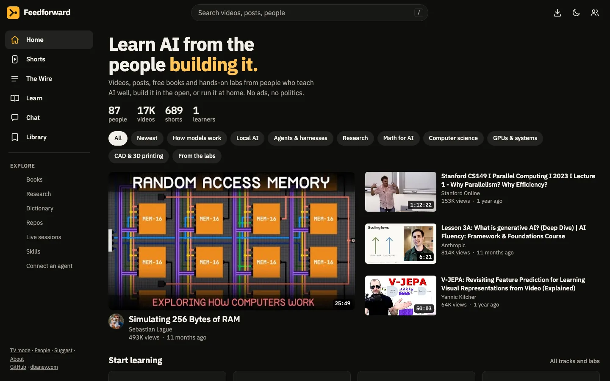
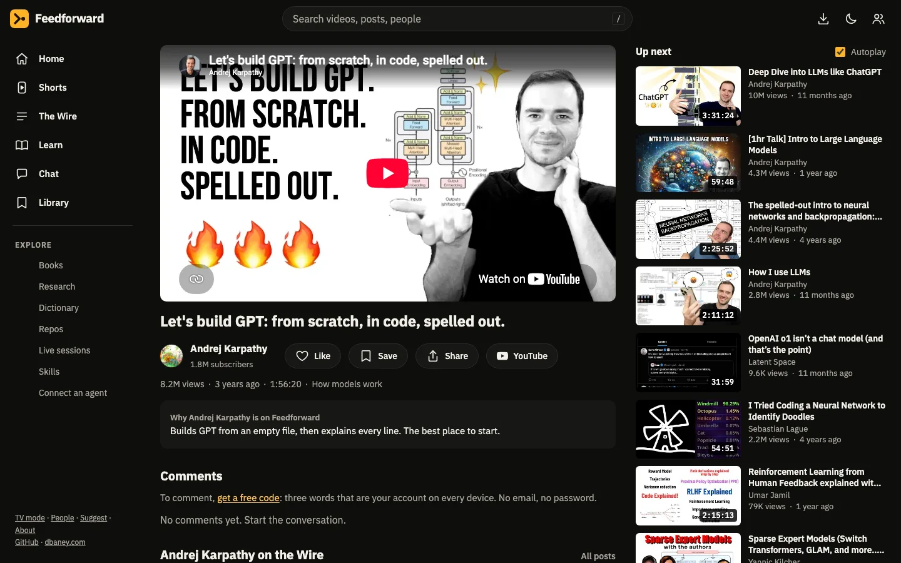
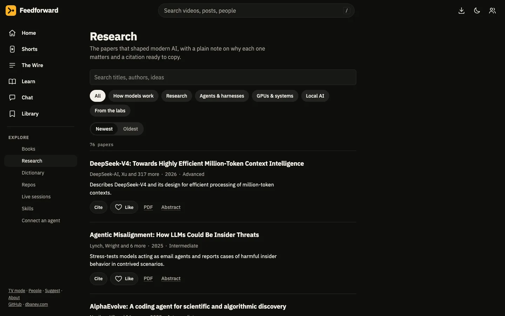
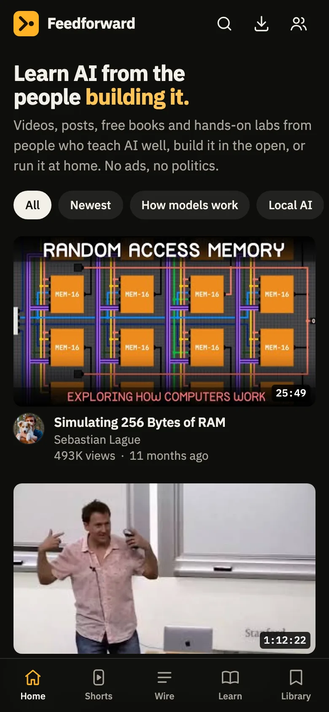

# Feedforward

**Learn AI from the people building it.** A free, invite-only learning hub that pulls the best AI, local AI, computer science and 3D printing videos, Shorts and posts from hand-picked people into one calm, fast app, with hands-on labs, free books, papers and a community.

[](https://github.com/baney75/feedforward/actions/workflows/check.yml)
[](LICENSE)
[](https://feedforward.dbaney.com)



## What's inside

- **Watch:** the full upload history of 54 channels (about 17,000 videos), plus 689 Shorts in a swipeable feed and a lean-back TV mode. A model labels every title, and politics, ads, personal posts and videos that can't be embedded are filtered out.
- **The Wire:** the best recent posts from 60+ people on X. Each post is kept only if it's technical and teaches something.
- **Learn:**
  - eight tracks, from "What an LLM actually is" to "How GPUs run AI", each with checks
  - seven labs that run in the browser: a real tokenizer, temperature and top-p sampling, a trainable neural net, a will-it-run memory calculator, a coding-agent loop, a 3D printing slicer, and a small language model running in your tab with tools and free search
- **Read:** 33 free books (including *Inference Engineering*), 76 landmark papers with one-tap APA, MLA, Chicago and BibTeX citations, a dictionary of 161 fact-checked terms, and the top open-source repos.
- **Community:**
  - invite-only membership: a member's invite link or a staff invite (which can grant a role), or apply and get in when staff approve
  - accounts with no email or password: a word code that works on every device, with QR sign-in
  - comments, likes, ratings, live chat rooms, and live sessions hosted by professors and tutors
  - shared agent skills, referral links, and roles with badges
- **Agents:** an MCP server that claude.ai, ChatGPT, Claude Code, Codex and other clients can add as a connector. See [docs/AGENTS.md](docs/AGENTS.md).
- **An app:** installable on phones and computers, with offline support and seven themes. No ads and no trackers.

| Watch | Research | On a phone |
| --- | --- | --- |
|  |  |  |

## Connect an agent

Feedforward is invite-only, so agents connect as you. In claude.ai or ChatGPT, add `https://feedforward.dbaney.com/mcp/me` as a custom connector; you approve it on Feedforward with OAuth and can revoke it any time. For Claude Code and other CLIs, make a token on your profile:

```sh
claude mcp add --transport http feedforward https://feedforward.dbaney.com/mcp \
  --header "Authorization: Bearer ffk_your_token"
```

## Run it yourself

Feedforward is a static app (no framework, no build step) served by one Cloudflare Worker with D1, R2, KV and a Durable Object for chat.

```sh
git clone https://github.com/baney75/feedforward && cd feedforward
echo "PEPPER=$(openssl rand -hex 32)" > .dev.vars
npx wrangler@4.154.0 d1 migrations apply feedforward --local
npx wrangler@4.154.0 dev           # the full app and API at http://localhost:8787 (keeps running)
```

In a second terminal:

```sh
npm test                                           # the repo checks
node scripts/api.smoke.mjs http://127.0.0.1:8787   # 84 end-to-end security checks
```

For front-end work alone, `npm run dev` serves `public/` at http://127.0.0.1:8790 with no API.

The catalog files are built by the data pipeline and aren't in git. [CONTRIBUTING.md](CONTRIBUTING.md) explains how to build them or work without them, and [docs/ARCHITECTURE.md](docs/ARCHITECTURE.md) describes the whole system.

## Contributing and security

Suggestions for people, videos, books, papers and terms are welcome, on the site's Suggest page or as an issue. Code contributions follow [CONTRIBUTING.md](CONTRIBUTING.md) and the [Code of Conduct](CODE_OF_CONDUCT.md). Report vulnerabilities privately as described in [SECURITY.md](SECURITY.md).

## Credits

Inspired by Andrej Karpathy's [HackerTube](https://hackertube.org/) and [TristanTube](https://karpathy.ai/tristan-tube/), and by 0xSero asking for the best AI education feed. Every video plays through YouTube's own player, and every post links back to X. Device codes use words from the [EFF short wordlist](https://www.eff.org/dice) (CC BY 3.0 US). Made by [Donovan Baney](https://dbaney.com).

MIT licensed.
